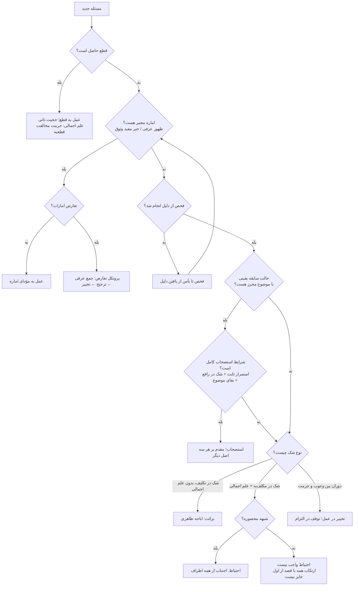

# الگوریتم اجتهادی شیخ انصاری — استخراج از فرائد الأصول و اعتبارسنجی بر مکاسب

**منابع:** دیتابیس‌های آپلودشده کاربر (مکاسب، ۶ جلد؛ فرائد الأصول، ۲ جلد). همه ارجاع‌ها «جلد/صفحه همین چاپِ دیتابیس» است. قواعد فقط از مواضع نتیجه‌بخش خود شیخ (عبارات «فالحق»، «والأقوى»، «والمختار» و مانند آن) استخراج شده‌اند، نه از اقوال منقول دیگران. مواردی که متن صریحشان در این مرور احراز نشد، در پایان سند فهرست شده‌اند.

**روش:** فرائد به‌مثابه «مشخصات الگوریتم» خوانده شد و مکاسب به‌مثابه «مجموعه آزمون». ۱۲ مسئله از مکاسب که شیخ در آن‌ها آشکارا به یک اصل عملی یا قاعده تعارض تکیه کرده، استخراج شد؛ سپس دو نسخه از الگوریتم روی هر مورد اجرا و خروجی با فتوای واقعی مقایسه شد:

- **نسخه ساده (Naive):** فقط فلوچارت چهار اصل (برائت/احتیاط/تخییر/استصحاب) بدون شروط و قواعد تقدم فرائد.
- **نسخه کامل (Refined):** همان فلوچارت + شروط احراز موضوع، تفصیل استصحاب، و قواعد ورود/حکومت/تقدم که از خود فرائد استخراج شد.

---

## ۱) معماری کلی: چهار لایه تصمیم

الگوریتم شیخ یک خط لوله (Pipeline) طبقه‌بندی‌شده است؛ هر لایه فقط وقتی فعال می‌شود که لایه بالاتر خروجی نداده باشد:

| لایه | ورودی | خروجی | مرجع |
|---|---|---|---|
| L0 قطع | یقین تفصیلی یا اجمالی | عمل به قطع؛ پایان مسیر | فرائد ج۱، مقصد اول |
| L1 ظن معتبر | اماره‌ای با دلیل خاص حجیت | عمل به مؤدّای اماره | فرائد ج۱، مقصد دوم |
| L2 اصول عملیه | شک بدون اماره معتبر | برائت / احتیاط / تخییر / استصحاب | فرائد ج۱ ص۳۲۴ به بعد و ج۲ |
| L3 تعارض | دو حجت متعارض | جمع عرفی ← ترجیح ← تخییر | فرائد ج۲، ص۳۵۱ به بعد |

نکته معماری: L3 در هر لایه می‌تواند رخ دهد (تعارض دو خبر در L1، تعارض دو استصحاب در L2) و پروتکل حلش در همه جا یکی است: **جمع مقبول، بعد ترجیح، بعد (در تکافؤ) تخییر — نه تساقط**.

---

## ۲) فلوچارت تصمیم



---

## ۳) شبه‌کد اجرایی

```
function ansari_ijtihad(masala):
    # L0 — قطع
    if qat_attained(masala):                       # incl. ilm ijmali: no qat'i violation
        return act_on_qat(masala)

    # L1 — ظن معتبر (فقط با دلیل خاص)
    amaras = find_amaras(masala)                   # zawahir urfi; khabar mufid al-wuthuq
    amaras = [a for a in amaras if has_hujjiyya_dalil(a)]
        # مستثنیات: اجماع منقول بما هو، شهرت فتوایی، ظن در تشخیص ظواهر، قیاس
    if amaras:
        if conflict(amaras):
            return resolve_conflict(amaras)        # L3 protocol
        return act_on(amara)

    # دروازه فحص — شرط همه اصول در شبهه حکمیه
    if not fahs_done(masala):                      # حد فحص: یأس از وجدان دلیل
        do_fahs(); retry L1

    # L2 — اصول عملیه؛ استصحاب اول، با شروط سخت‌گیرانه
    if has_sabiqa_yaqiniyya(masala):
        s = istishab_candidate(masala)
        if s.istimrar_established and s.shak_fi_rafi' and s.mawdu'_muhraz:
            return apply_istishab(s)               # وارد بر برائت/اشتغال/تخییر
        # در غیر این صورت استصحاب ساقط است؛ سقوطش خودش خروجی مهمی است (نمونه ۴)

    match classify_shak(masala):
        case SHAK_FI_TAKLIF:            return BARA'A      # اباحه ظاهری
        case SHAK_FI_MUKALLAF_BIH + ILM_IJMALI:
            if mahsura(masala):         return IHTIYAT     # اجتناب از جمیع
            else:                       return IHTIYAT_NOT_WAJIB (with limits)
        case DAWARAN_BAYN_MAHzURAYN:   return TAKHYIR     # عملاً؛ و توقف در التزام

function resolve_conflict(x, y):                   # L3 — در هر لایه
    if jam'_urfi_possible(x, y):    return jam'    # جمع مقبول مقدم بر طرح
    if tarjih_dalali(x, y):         return aẓhar   # اظهر مقدم بر همه مرجحات
    for murajjih in [شهرت/شذوذ, اعدلیت/اوثقیت, مخالفت عامه, مخالفت میل حکام,
                     هر مزیت موجب اقربیت به واقع، از جمله موافقت کتاب و سنت]:
        if murajjih_applies:        return preferred
    return TAKHYIR                                  # تکافؤ: تخییر، نه تساقط
    # استثنا: تعارض دو استصحابِ بی‌مرجّح با علم اجمالی به ارتفاع یکی → تساقط
```

---

## ۴) جدول قواعد مستند

### الف) لایه قطع (فرائد ج۱، مقصد اول)

| # | قاعده | ارجاع | شاهد |
|---|---|---|---|
| ق۱ | حجیت قطع ذاتی است و طریقیتش قابل جعل شارع نیست؛ میان اسباب قطع فرقی نیست | ج۱ ص۲۱ | «ليس طريقيته قابلة لجعل الشارع إثباتا أو نفيا» |
| ق۲ | قطع از مقدمات عقلیه هم حجت است؛ دلیل نقلی معارض آن باید تأویل شود | ج۱ ص۳۲ | «كلما حصل القطع من دليل عقلي فلا يجوز أن يعارضه دليل نقلي» |
| ق۳ | قطعِ قطّاع از حیث طریقیت معتبر است؛ «عدم اعتبار» فقط در احکامی است که قطع در آن‌ها موضوعیت دارد | ج۱ ص۳۹ | «عدم اعتباره في الأحكام التي يكون القطع موضوعا لها كقبول شهادته وفتواه... فهو حق» |
| ق۴ | علم اجمالی در حرمت مخالفت قطعیه مانند تفصیلی منجّز است، در شبهه حکمیه و موضوعیه | ج۱ ص۴۴ | «عدم الجواز مطلقا لأن مخالفة الشارع قبيحة عقلا» |
| ق۵ | امتثال اجمالی («آوردن هر دو محتمل به قصد مأموربه») قاعدهً کافی است | ج۱ ص۴۱–۴۳ | «مقتضى القاعدة جواز الاقتصار في الامتثال بالعلم الإجمالي» |

### ب) لایه ظن (فرائد ج۱، مقصد دوم)

| # | قاعده | ارجاع | شاهد |
|---|---|---|---|
| ق۶ | اصل اولی: تعبد به ظنِ بدون دلیل خاص، به ادله اربعه حرام است (عمل از باب احتیاط/رجا، تعبد نیست و مستثناست) | ج۱ ص۶۶–۶۹ | «التعبد بالظن الذي لم يدل دليل على التعبد به محرم بالأدلة الأربعة» |
| ق۷ | ظواهر کتاب و سنت حجت است؛ مناط، ظهور عرفی است نه ظن شخصی فعلی؛ فحص از قرینه صارف پیش از عمل لازم است | ج۱ ص۷۲–۸۹ | «فلا فرق بين إفادته الظن بالمراد وعدمها» |
| ق۸ | ظن در «تشخیص ظواهر» (مثل قول لغوی) حجت نیست؛ فقط خود ظواهر حجت‌اند | ج۱ ص۹۱ | «الثابت المتيقن هي حجية الظواهر وأما حجية الظن في أن هذا ظاهر فلا دليل عليه» |
| ق۹ | اجماع منقول بما هو اجماع حجت نیست (اخبار عن حدس است)؛ حكایت ناقل فقط در محسوساتش تصدیق می‌شود | ج۱ ص۹۴–۱۲۰ | «عدم الملازمة بين حجية الخبر وحجية الإجماع المنقول» |
| ق۱۰ | شهرت فتوایی ظن خاص نیست و دلیل خاص ندارد؛ مرجّح روایی بودن شهرت، ربطی به شهرت فتوایی ندارد | ج۱ ص۱۲۲–۱۲۴ | «المقصود... إبطال توهم كونها من الظنون الخاصة» |
| ق۱۱ | خبر واحد حجت است با معیار «افاده وثوق و اطمینان»؛ ملاک قبول، وثاقت راوی است نه عدالت بما هی؛ خبر ثقه غیرامامی هم با همین ملاک پذیرفته می‌شود | ج۱ ص۱۵۵–۱۹۱ | «لم يدل إلا على وجوب العمل بما يفيد الوثوق والاطمئنان بمؤداه»؛ «الغرض من العدالة حصول الوثاقة فيكون العبرة بها» |
| ق۱۲ | انسداد: نتیجه فقط «مهمله» است (وجوب عمل به ظن فی‌الجمله، بدون تعمیم در اسباب و موارد و مرتبه) و تقریر درست آن «حکومت» عقل است نه کشف جعل شارع؛ حاصل عملی: دست نکشیدن از احتیاط مگر با اطمینان به خلاف | ج۱ ص۲۴۴–۲۶۸ | «الحق في تقرير دليل الانسداد هو التقرير الثاني وأن التقرير على وجه الكشف فاسد»؛ «عدم رفع اليد عن الاحتياط في الدين مهما أمكن إلا مع الاطمئنان بخلافه» |
| ق۱۳ | قیاس حتی به‌عنوان مرجّح هم ممنوع است (نهی خاص)؛ اگر از آن قطع حاصل شود، دیگر قیاس نیست بلکه قطع است | ج۱ ص۲۷۵–۳۱۳ | «النهي يكشف عن وجود مفسدة غالبة على المصلحة الواقعية» |

### ج) اصول عملیه (فرائد ج۱ ص۳۲۴ به بعد؛ ج۲)

| # | قاعده | ارجاع | شاهد |
|---|---|---|---|
| ق۱۴ | برائت: در شک در تکلیف بدون علم اجمالی، حکم ظاهری اباحه است؛ برائت عقلی و شرعی هر دو جاری‌اند، در شبهه وجوبیه هم | ج۱ ص۳۵۲–۳۹۷ | «كون الحكم الظاهري في الفعل المشتبه الحكم هي الإباحة»؛ «الأقوى فيه جريان أصالة البراءة للأدلة الأربعة» |
| ق۱۵ | شرط یگانه برائت در شبهه حکمیه: فحص؛ حدّش یأس از یافتن دلیل در منابع در دسترس. در شبهه موضوعیه فحص شرط نیست | ج۲ ص۱۱۲–۱۳۰ | «ليس لها إلا شرط واحد وهو الفحص عن الأدلة الشرعية»؛ «حد الفحص هو اليأس عن وجدان الدليل» |
| ق۱۶ | احتیاط: در شبهه تحریمیه محصوره، اجتناب از هر دو مشتبه واجب و مخالفت قطعیه حرام است؛ ضابط «محصور» عرفی است و هنگام شک در ضابط، رجوع به اصالة الاحتیاط اقوی است | ج۲ ص۶–۳۹ | «فالحق فيه وجوب الاجتناب عن كلا المشتبهين»؛ «الأقوى وجوب الرجوع مع الشك إلى أصالة الاحتياط» |
| ق۱۷ | در شبهه غیرمحصوره وجوب اجتناب از همه نیست، اما ارتکاب همه با قصد از ابتدا جایز نیست | ج۲ ص۳۷ | «الأقوى في المسألة عدم جواز الارتكاب إذا قصد ذلك من أول الأمر» |
| ق۱۸ | در اقل و اکثر (شک در جزئیت) برائت از جزء مشکوک جاری است؛ ادله برائت فقط کلفت زائده را نفی می‌کند | ج۲ ص۸۱ | «أدلة البراءة من العقل والنقل إنما تنفي الكلفة الزائدة» |
| ق۱۹ | تخییر: در دوران بین وجوب و حرمت، در مقام عمل تخییر است؛ اما در مقام التزام و تدیّن به یکی، مختار شیخ توقف است. اگر دوران از تعارض ادله باشد، حکم صریح تخییر است؛ و تخییر استمراری است نه بدوی (به حکم عقل، نه استصحاب) | ج۱ ص۴۱۴–۴۱۸ | «الأقوى في المسألة التوقف واقعا وظاهرا»؛ «فالحكم هنا التخيير»؛ «الأقوى هو التخيير الاستمراري لا للاستصحاب بل لحكم العقل» |

### د) استصحاب (فرائد ج۲، ص۱۴۳–۳۵۰)

| # | قاعده | ارجاع | شاهد |
|---|---|---|---|
| ق۲۰ | تعریف: «إبقاء ما كان» یعنی حکم عقل/شارع به بقای حالت سابقه | ج۲ ص۱۴۳ | «أسدها وأخصرها (إبقاء ما كان) والمراد بالإبقاء الحكم بالبقاء» |
| ق۲۱ | **تفصیل کلیدی (قول نهم، مختار شیخ):** استصحاب فقط وقتی حجت است که استمرار مستصحب به دلیل خودش یا از خارج ثابت باشد و شک در «غایت رافع» باشد؛ در شک در مقتضی/سکوت دلیل، حجت نیست | ج۲ ص۱۶۲–۱۶۳ | «التفصيل بين كون المستصحب مما ثبت بدليله أو من الخارج استمراره فشك في الغاية الرافعة وبين غيره»؛ «الأقوى هو القول التاسع» |
| ق۲۲ | مبنای حجیت، اخبار مستفیضه است؛ عقل به‌تنهایی حجیتی برای استصحاب ثابت نمی‌کند | ج۲ ص۲۰۲ | «فالحق مع قطع النظر عن الروايات عدم حجية الاستصحاب» |
| ق۲۳ | دامنه آثار: فقط آثار شرعی مترتب می‌شود، نه آثار عقلی و عادی. استصحاب کلی فی‌الجمله جاری است، اما در کلیِ مقیّد به زمان جاری نیست | ج۲ ص۲۴۰–۲۶۱ | «إنما يفيد ترتيب الأحكام والآثار الشرعية»؛ «ينبغي القطع بعدم جريان الاستصحاب في الكلي [المقيد بالزمان]» |
| ق۲۴ | ارکان: (۱) بقای موضوع در زمان لاحق (وحدت عرفی موضوع)، (۲) یقین به وجود مستصحب در سابق هنگام شک، (۳) نامعلوم بودن هم بقا و هم ارتفاع | ج۲ ص۲۹۲–۳۰۵ | «بقاء الموضوع في الزمان اللاحق»؛ «أن يكون في حال الشك متيقنا بوجود المستصحب في السابق» |
| ق۲۵ | تقدم‌ها: ید بر استصحاب حاکم است (معارضه نمی‌کند)؛ اصالة الصحه در عملِ بعد فراغ و در فعل غیر، بر استصحاب مقدم/وارد است؛ استصحاب بر برائت وارد است و بر هر سه اصل عملیه تقدم دارد | ج۲ ص۳۰۸–۳۳۵ | «اليد مما لا يعارضها الاستصحاب بل هي حاكمة عليه»؛ «أصالة البراءة فلا تعارض الاستصحاب»؛ عنوان بخش: «تقديم الاستصحاب على الأصول الثلاثة» |
| ق۲۶ | تعارض دو استصحاب: سببی بر مسببی مقدم است؛ اگر هر دو مسبب از امر ثالث باشند و مرجّح نباشد و علم اجمالی به ارتفاع یکی باشد: **تساقط، نه تخییر** (استثنای مهم بر ق۱۹) | ج۲ ص۳۴۰–۳۴۸ | «فالحق التساقط دون التخيير» |

### ه) تعادل و تراجیح (فرائد ج۲، ص۳۵۱–۴۲۶)

| # | قاعده | ارجاع | شاهد |
|---|---|---|---|
| ق۲۷ | ترتیب: اول جمع عرفی مقبول؛ ترجیح دلالی (ظاهر/اظهر) مقدم بر همه مرجحات دیگر است | ج۲ ص۳۸۱–۳۸۶ | «بعد الفراغ عن تقديم الجمع المقبول على الطرح»؛ «تعارض الظاهر والأظهر فلا ينبغي الارتياب في عدم ملاحظة المرجحات الأخر» |
| ق۲۸ | ترتیب مرجحات منصوص: شهرت و شذوذ ← اعدلیت و اوثقیت ← مخالفت عامه ← مخالفت میل حکّام. مرجحات منحصر به منصوصات نیستند: هر مزیّتی (داخلی: سند، متن، وجه صدور؛ خارجی: مانند موافقت کتاب و سنت) که اقربیت به واقع بدهد، مرجّح است | ج۲ ص۳۸۱–۴۲۰ | «الترجيح أولا بالشهرة والشذوذ ثم بالأعدلية والأوثقية ثم بمخالفة العامة ثم بمخالفة ميل الحكام»؛ «الكتاب والسنة والترجيح بموافقتهما مما تواتر به الأخبار» |
| ق۲۹ | تکافؤ: تساقط نیست؛ حکم تخییر است (اخبار مستفیضه بلکه متواتره)، ولی رجوع به تخییر فقط بعد از فحص تام از مرجحات جایز است | ج۲ ص۳۶۴–۳۶۷ | «الأخبار المستفيضة بل المتواترة قد دلت على عدم التساقط مع فقد المرجح»؛ «الرجوع إلى التخيير غير جائز إلا بعد الفحص التام عن المرجحات» |

**موارد تأییدنشده در این مرور (صداقت روش):** قبول/ردّ تک‌تک شروط اضافی فاضل تونی برای برائت؛ استدلال مستقل تقدم استصحاب بر اشتغال و تخییر (عنوان و نتیجه کلی بخش احراز شد)؛ حکم نهایی تعارض استصحاب و قرعه؛ بدوی یا استمراری بودن تخییر در تعادل خبرین.

---

## ۵) اعتبارسنجی بر مکاسب — ۱۲ مورد

### هشدار روش‌شناختی (پیش از نتایج)

نمونه‌ها با جستجوی کلیدواژه‌های اصولی در مکاسب پیدا شدند؛ یعنی نمونه از پیش «به شرط کاربرد آشکار اصل» گزیده شده است و فقط لایه اصول عملیه/تعارض را می‌آزماید، نه لایه ارزیابی روایات و نه لایه تشخیص موضوع. پیش‌بینی‌ها نیز پس از دانستن نتایج بازسازی شده‌اند. پس نرخ توافق زیر، «کفایت توصیفی مجموعه قواعد استخراج‌شده برای موارد اصل‌محور» را نشان می‌دهد، نه توان پیش‌بینی کور. آزمون کور درست در بخش ۷ طراحی شده است.

### جدول موارد

| # | مسئله (مکاسب) | وضعیت مسئله | مسیر الگوریتم کامل | پیش‌بینی | فتوای واقعی شیخ | نتیجه |
|---|---|---|---|---|---|---|
| ۱ | الأصل في البيع اللزوم (ج۵، ص۱۳–۲۴) | شک در زوال اثر عقد با فسخ یک‌طرفه؛ استمرار اثر عقد ثابت | استصحاب اثر عقد (ق۲۱: شک در رافع) | لزوم | لزوم؛ «ذلك مقتضى الاستصحاب أيضا» (ص۲۲) | ✅ توافق |
| ۲ | شک در عقد خارجی: هبه یا صدقه؟ (ج۵، ص۲۴) | شک موضوعی؛ قصد قربت (رکن صدقه) سابقه یقینی ندارد | اصول موضوعیه: أصالة عدم قصد القربة | هبه جایز | «الأصل عدم قصد القربة، فيحكم بالهبة الجائزة» | ✅ توافق |
| ۳ | اصل در معاطات از حیث لزوم (ج۳، ص۹۶) | سابقه یقینی: سلطنت مالک؛ در برابرش بقای اباحه | تعارض دو استصحاب → حاکمیت استصحاب سلطنت (ق۲۵–۲۶) | عدم لزوم | «الأصل عدم اللزوم، لأصالة سلطنة المالك... وهي حاكمة على أصالة بقاء الإباحة» | ✅ توافق (فقط با قواعد تقدم) |
| ۴ | خیار غبن: فور یا تراخی؟ (ج۵، ص۲۰۶–۲۱۲) | سابقه: ثبوت خیار؛ اما موضوع استصحاب (مغبونِ عاجز از تدارک) در زمان دوم محرز نیست | استصحاب به‌سبب نقض ق۲۴ (عدم احراز بقای موضوع) ساقط → رجوع به أصالة بقاء آثار العقد | فوریت | «الأقوى كون الخيار هنا على الفور» (ص۲۱۲) | ✅ توافق — نسخه ساده این‌جا غلط می‌گوید (تراخی) |
| ۵ | تعارض مقوّمان در ارش (ج۵، ص۴۰۵–۴۰۸) | دو بینه حجت، متعارض در مقدار | پروتکل تعارض: جمع مقبول (تنصیف) مقدم بر قرعه و ترجیح (ق۲۷)؛ برائت مرجّح دلیل اجتهادی نمی‌شود | جمع بین بینتین | «الأقوى... وجوب الجمع بينهما بقدر الإمكان»؛ «قاعدة الجمع حاكمة على دليل القرعة» | ✅ توافق |
| ۶ | اختلاف در تغییر مبیعِ دیده‌شده (ج۴، ص۲۷۱–۲۸۳) | شک در انطباق عین خارجی بر متعلق عقد؛ اصالة اللزوم پیش‌فرضِ «وصول حق مشتری» را لازم دارد | اصل موضوعی (أصالة عدم وصول حق المشتري) وارد بر اصالة اللزوم | خیار برای مشتری | «المرجع هو أصالة عدم وصول حق المشتري إليه» (ص۲۸۳) | ✅ توافق — نسخه ساده این‌جا غلط می‌گوید (لزوم، بدون خیار) |
| ۷ | صور جواز بیع وقف (ج۴، ص۸۹–۹۳) | سابقه: وقفیت و منع؛ برای بیشتر صورت‌ها دلیل معتبر بر جواز نیست | استصحاب بقای وقفیت و منع + عمومات نهی (ق۲۱) | منع فروش | «الأقوى: ... المنع في غيره»؛ «مضافا إلى الاستصحاب في جميع هذه الصور» (ص۹۳) | ✅ توافق |
| ۸ | جوائز سلطان در شبهه محصوره (ج۲، ص۱۷۴–۱۸۲) | علم اجمالی به وجود حرام در اطراف محصورِ مورد ابتلا | گره اشتغال: علم اجمالی + محصوره → احتیاط حاکم بر اطلاقات حلیت (ق۱۶) | وجوب اجتناب | «قاعدة الاحتياط لزوم الاجتناب عن الجميع»؛ «فلم يثبت... إلغاء تلك القاعدة» | ✅ توافق |
| ۹ | شرط مشکوک‌المخالفه با کتاب (ج۶، ص۳۱) | پس از تأمل، مخالفت شرط با حکم ثابتِ غیرقابل تغییر احراز نمی‌شود | أصالة عدم المخالفة + عموم «المؤمنون عند شروطهم» | صحت و لزوم شرط | «بنى على أصالة عدم المخالفة، فيرجع إلى عموم: المؤمنون عند شروطهم» | ✅ توافق |
| ۱۰ | مشکوک‌المثلیة و القیمیة (ج۳، ص۲۱۶) | اشتغال ذمه ضامن یقینی؛ شک در کیفیت برائت ذمه | گره اشتغال: برائت ذمه نیازمند یقین/رضای مالک؛ برائت از طرف ضامن کافی نیست | اختیار با مالک | «الأقوى: تخيير المالك من أول الأمر، لأصالة الاشتغال» | ✅ توافق |
| ۱۱ | انتفاع از روغن متنجس در غیر استصباح (ج۱، ص۱۲۸–۱۳۰) | شک در حرمت انتفاعات دیگر؛ نصوص منع ناظر به اکل و شرب و استصباح‌اند | برائت پس از فحص (ق۱۴–۱۵): جواز انتفاع الا ما خرج بالدلیل | جواز | «الأقوى... جواز الانتفاع» (ص۱۳۰) | ✅ توافق |
| ۱۲ | أصالة الصحة در فعل متصدی معروف (ج۳، ص۵۶۸–۵۶۹) | صدور فعل (نماز میت) معلوم، صحتش مشکوک، بعد از فراغ | اصالة الصحة وارد بر استصحاب (ق۲۵) | صحت فعل و سقوط تکلیف از دیگران | «أحرزت بأصالة الصحة»؛ «فالظاهر سقوطها عن غيره» | ✅ توافق |

### نتیجه عددی

- **نسخه ساده (فلوچارت چهار اصل، بدون شروط و تقدم‌ها):** ۹ توافق، ۲ خطا (مورد ۴ و ۶)، ۱ نامعین (مورد ۳: دو استصحاب رقیب بدون قاعده حل).
- **نسخه کامل (با شروط و قواعد فرائد):** ۱۲ از ۱۲ توافق.

### تحلیل: اختلاف‌ها کجا بودند و چه چیزی نجات داد؟

هر دو خطای نسخه ساده از یک جا آمد: **نادیده گرفتن پیش‌شرط‌ها و ترتیب اصول**. سه سازوکار فرائد نتیجه را برمی‌گرداند:

1. **شرط احراز بقای موضوع در استصحاب (ق۲۴)** — مورد ۴: استصحابِ به‌ظاهر آماده (خیار ثابت بوده، حالا شک در بقایش) چون موضوعش در زمان دوم محرز نیست، اصلاً به دنیا نمی‌آید. الگوریتم ساده این‌جا مستقیم به پاسخ اشتباه می‌رسد.
2. **تقدم اصل موضوعی بر اصل حکمی (ق۲۵ در عمل)** — مورد ۶: اصالة اللزوم وقتی جاری است که «وصول حق مشتری» احراز شده باشد؛ اصلِ ناظر به خود موضوع، وارد بر آن است.
3. **حکومت در تعارض استصحاب‌ها (ق۲۶)** — مورد ۳: بقای سلطنت مالک و بقای اباحه هر دو سابقه دارند؛ بدون قاعده حکومت، الگوریتم بن‌بست می‌خورد.

این دقیقاً همان نقطه‌ای است که «الگوریتم شیخ» از یک فلوچارت کتاب درسی اصول جدا می‌شود: ارزش فرائد در همین شروط، استثناها و ترتیب‌هاست، و استخراجِ بدون آن‌ها نه‌تنها ناقص، بلکه در یک‌ششم نمونه‌ها گمراه‌کننده است.

---

## ۶) حدود این استخراج — چه چیزی الگوریتمی نشد

1. **لایه تشخیص موضوع:** اینکه «این عقد صدقه است یا هبه»، «این شبهه محصوره است یا نه»، «ظهور عرفی این لفظ چیست» — الگوریتم این‌ها را ورودی می‌گیرد، تولید نمی‌کند. در عمل اجتهاد، سهم بزرگی از اختلاف فتوا همین‌جاست.
2. **لایه ارزیابی وثوق:** معیار خبر معتبر «افاده وثوق و اطمینان» است (ق۱۱) — یک آستانه عرفی/وجدانی، نه تابع محاسباتی. الگوریتم جای این قضاوت را مشخص می‌کند، ولی خودش آن را انجام نمی‌دهد.
3. **وزن‌دهی مرجحات غیرمنصوص:** ق۲۸ در را به روی «هر مزیت موجب اقربیت» باز می‌گذارد؛ تشخیص اقربیت، قضاوت است نه محاسبه.
4. **مکاسب فقط فقه معاملات است** و در آن، اصول عملیه سهم پررنگی دارند. تعمیم نرخ توافق به ابواب عبادات یا به کتاب‌های دیگر شیخ، بدون آزمون جدا موجه نیست.

برآورد صادقانه: آنچه استخراج شد «موتور تصمیم پس از تشخیص» است — احتمالاً بخش رویه‌ای و قابل‌قاعده‌سازی روش شیخ، نه کل اجتهاد او.

---

## ۷) گام بعدی پیشنهادی: آزمون کور (پیش‌ثبت‌شده)

برای اینکه نرخ توافق از «توصیف گذشته» به «پیش‌بینی آینده» تبدیل شود:

- **نمونه‌گیری:** ۲۰ مسئله به‌صورت تصادفی از فهرست (TOC) هر ۶ جلد مکاسب، بدون جستجوی کلیدواژه اصولی؛ بذر تصادفی و فهرست مسائل پیش از هر خواندنی ثبت شود.
- **رویه کور:** برای هر مسئله فقط صورت مسئله و ادله مطرح‌شده خوانده شود؛ مسیر الگوریتم و پیش‌بینی حکم در فایل مهروموم‌شده (با هش و تاریخ) ثبت شود؛ **بعد** نتیجه‌بخش مسئله خوانده و مقایسه شود.
- **معیار از پیش تعیین‌شده:** توافق ≥ ۸۰٪ یعنی الگوریتم در ابواب معاملات قدرت پیش‌بینی دارد؛ ۵۰ تا ۸۰٪ یعنی لایه‌های قضاوتی سهم غالب دارند و باید همان‌ها موضوع استخراج بعدی شوند؛ کمتر از ۵۰٪ یعنی این استخراج عمدتاً بازنویسی گذشته بوده است.
- **گزارش:** هر سه دسته (توافق/اختلاف/نامعین) با همان قالب جدول بخش ۵ منتشر شود؛ موارد اختلاف به تفکیک «خطای طبقه‌بندی شک»، «خطای تشخیص موضوع»، «مرجّح غیرمنصوص» و «سایر» کدگذاری شوند تا معلوم شود سقف الگوریتم دقیقاً کجاست.

---

*این سند حاصل کار روی دیتابیس‌های آپلودشده کاربر است؛ نقل‌قول‌های عربی کوتاه و صرفاً برای ارجاع و راستی‌آزمایی آمده‌اند. شماره صفحات مربوط به چاپ همین دیتابیس‌هاست و با چاپ‌های دیگر ممکن است متفاوت باشد.*

---

## پیوست: نتیجه آزمون کور (۲۰۲۶-۱۰-۱۵، پس از نگارش سند)

طرح بخش ۷ اجرا شد: ۲۰ بخش به‌صورت تصادفی از فهرست هر ۶ جلد مکاسب (بذر ۲۰۲۶۱۰۱۵، چارچوب ۱۶۱۴ مدخل) انتخاب شد؛ پیش‌بینی‌ها پیش از گشودن نتایج، با هش SHA-256 مهروموم شدند؛ نتایج واقعی توسط استخراج‌کنندگان مستقل خوانده شد.

- پیش‌بینی معیّن: ۱۷ از ۲۰ (پوشش ۸۵٪)؛ نامعین: ۳.
- **توافق کامل: ۱۵ از ۱۷ پیش‌بینی معیّن (۸۸٪)**؛ ۱ توافق جزئی (ماضویت صیغه: جهت درست، ولی شیخ فتوای مشروط داد نه قاطع)؛ ۱ اختلاف (تبری از عیوب متجدده: شیخ با بازتفسیر شرط به «عدم تعهد به سلامت» آن را تصحیح کرد، نه رد).
- حکم بر معیار پیش‌ثبت‌شده: آستانه ۸۰٪ در میان احکام معیّن رد شد — الگوریتم قدرت پیش‌بینی واقعی دارد، نه فقط کفایت توصیفی. نرخ سخت‌گیرانه کل: ۱۵ از ۲۰ (۷۵٪).
- یافته ساختاری: در نمونه تصادفی، بیشتر موارد در لایه L1 (ظهور/اطلاق/قدر متیقّن) حل شدند، نه موتور اصول عملیه؛ اصول عملیه نقش ذخیره دارند.
- سقف الگوریتم: بازتفسیر مفاد شروط و فتوای مشروط — لایه قضاوتی. گزارش کامل، پروتکل، بسته‌های کور و هش‌ها: پوشه `ansari-blind-test` در محیط کاری Muse (پیش‌ثبت، نمونه، بسته‌ها، پیش‌بینی مهروموم و گزارش آزمون کور).
